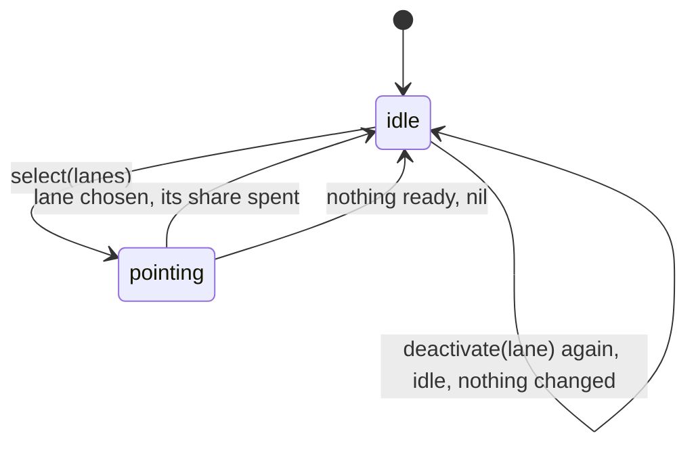
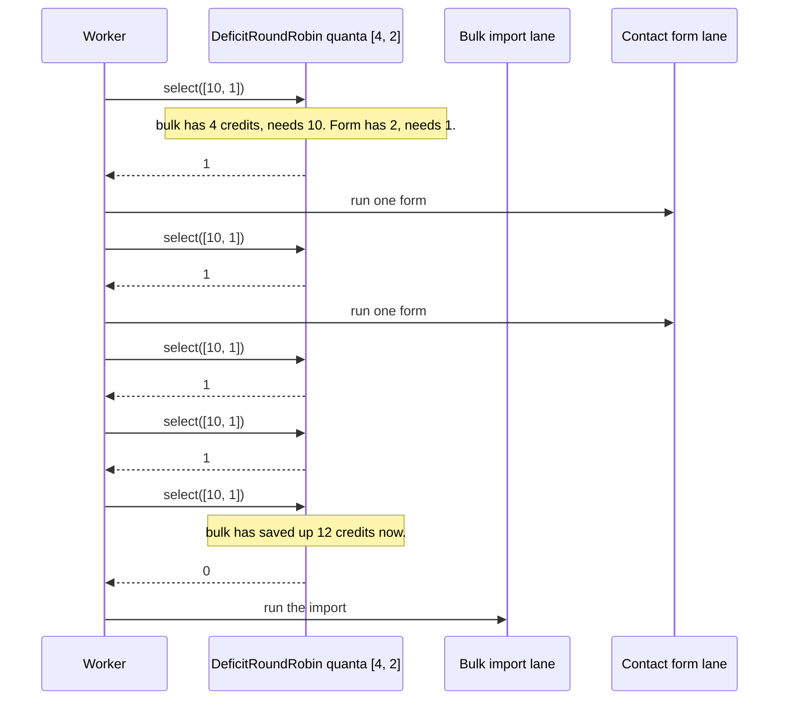

# PriorityMachines

> Everyone's job is urgent. Someone still has to pick who goes next. 🚀

Ways to answer "which lane now?" for Ruby. Round robin hands out turns in order, and weighted round robin hands them out by weight. Deficit round robin hands out turns by cost, so a lane full of heavy jobs can't hog the worker. Earliest deadline first picks whoever is closest to being late. You keep the queues. The scheduler just points.

## Quick Start

```bash
gem 'priority_machines'
```

```ruby
# Three tenants, three queues. Enterprise gets three turns for every one the others get.
turns = PriorityMachines::WeightedRoundRobin.new([3, 1, 1])

loop do
  ready = queues.map { |q| !q.empty? }        # [true, false, true]
  lane = turns.select(ready) or break          # => 0, 0, 0, 2, 0, 0, 0, 2 ...
  run(queues[lane].shift)
end
```

Weighted by cost instead of count? Tell it what the next job in each lane will cost:

```ruby
credit = PriorityMachines::DeficitRoundRobin.new([4, 2])
credit.select([3, 1])   # => 0, lane 0 has 4 credits and its head costs 3
```

Racing a clock? Give it the deadlines, in nanoseconds, and it points at the nearest one:

```ruby
PriorityMachines.earliest_deadline([nil, 2_500_000_000, 1_000_000_000])   # => 2
```

## A Message to the Resistance

So you have one worker pool and three customers. The big one uploads a 40 GB CSV every night. The small ones upload a contact form. Your queue is FIFO, which is a polite way of saying the contact forms wait behind 40 GB of someone else's rows.

You tried priority levels. Now the big customer's jobs are all "high" too, because their account manager asked nicely.

The problem was never the ordering. It's that "next" has no memory. Round robin fixes count: everyone gets a turn. But a turn that costs a million rows is not the same as a turn that costs one, so you need a scheduler that remembers who already spent their share. And when the question is "who is about to miss an SLA," neither of those is the answer; the deadline is.

This gem is those three answers, with nothing else attached. No threads, no queues, no clock. You ask, it points at a lane.

## Chapter 1: Stardate 2025.186, the AMS Liu

> **AMS Liu**, NCC-4215, *Liu*-class dispatch escort.
> Every shuttle says its launch is urgent. Someone still has to order the queue.

The escort doesn't fly anyone anywhere. It stands on the pad with a clipboard. Three bays, three pilots all claiming priority. The escort knows how many launches each bay was promised, how much fuel each launch burns, and which flight plan runs out of window first. It points. The bay launches. It points again.

On the pad, a dispatcher mutters:

```ruby
def next_job
  jobs.sort_by { |j| [-j.priority, j.enqueued_at] }.first
end
```

"That," says the escort, "is why the hangar is full of contact forms."

## The Flight Plan

Each scheduler keeps a little state per lane and moves it on every `select`.



The night the big customer's import finally waited its turn:



## Weighted Round Robin

One turn per weight unit, round after round. Pass an array of booleans saying which lanes have something waiting.

```ruby
turns = PriorityMachines::WeightedRoundRobin.new([3, 1])
Array.new(8) { turns.select([true, true]) }   # => [0, 0, 0, 1, 0, 0, 0, 1]
```

A lane that isn't ready is skipped, not saved up:

```ruby
turns = PriorityMachines::WeightedRoundRobin.new([3, 1])
Array.new(4) { turns.select([false, true]) }  # => [1, 1, 1, 1]
```

Nothing ready anywhere returns `nil`. That `nil` is an answer, not a refusal, and the round still counted: the lane that was mid-burst forfeits its unused turns and starts its next burst at full weight. Weights are positive Integers, zero to sixteen lanes.

When a lane's queue drains or is removed, say so before you reuse the lane, so a half-spent burst doesn't carry over:

```ruby
turns = PriorityMachines::WeightedRoundRobin.new([3, 1])
turns.select([true, true])   # => 0, two turns left in lane 0's burst
turns.deactivate(0)          # => :deactivated, the burst is given up
turns.deactivate(0)          # => :idle, already given up, nothing changed
turns.deactivate(7)          # => :unknown_lane, nothing changed
```

## Round Robin

The unweighted case, with no fixed lane count. The array you pass sets the lanes on every call, so lanes can appear and vanish, and the cursor wraps.

```ruby
turns = PriorityMachines::RoundRobin.new
turns.select([false, true, true])   # => 1
turns.select([false, true, true])   # => 2
turns.select([true, true])          # => 0
turns.cursor                        # => 1, where the next search starts
turns.select([false, false])        # => nil, and the cursor stays at 1
```

## Deficit Round Robin

Each lane earns `quanta[lane]` credits per round. A lane is served when its credit covers the cost of its head job, and leftover credit carries forward. Pass the cost of the head job per lane, or `nil` for an empty lane.

```ruby
credit = PriorityMachines::DeficitRoundRobin.new([3, 1])
Array.new(8) { credit.select([1, 1]) }   # => [0, 0, 0, 1, 0, 0, 0, 1]
```

Same shape as weighted when every job costs one. Now make lane 0's jobs cost three:

```ruby
credit = PriorityMachines::DeficitRoundRobin.new([4, 2])
Array.new(6) { credit.select([3, 1]) }   # => [0, 1, 1, 0, 1, 1]
```

Lane 0 gets one heavy job per round. Lane 1 gets two light ones. Nobody starves, and the heavy lane can't buy extra turns by being heavy.

If a lane drains, throw away what it had saved so it doesn't come back with a windfall:

```ruby
credit.deactivate(0)   # => :deactivated, its credit is gone
credit.deactivate(0)   # => :idle, nothing left to throw away
credit.deactivate(99)  # => :unknown_lane, no such lane
```

An empty lane is `nil`; costs are positive Integers. Every `select` reads the lanes you marked empty and zeroes their credit, including the `select` that finds every lane empty and answers `nil`. That `nil` also ends the visit in progress, so the lane under the cursor is paid a fresh quantum when work comes back. The cursor doesn't move, and a second `nil` in a row changes nothing.

## Earliest Deadline First

No state at all. Hand it one deadline per lane, as Integer nanoseconds on whatever monotonic clock you use, with `nil` for lanes that have nothing. Get back the lane with the nearest deadline, lowest index on a tie.

```ruby
now = Process.clock_gettime(Process::CLOCK_MONOTONIC, :nanosecond)
PriorityMachines.earliest_deadline([now + 10_000_000_000, nil, now + 250_000_000])   # => 2
PriorityMachines.earliest_deadline([5, 5, 1])                                        # => 2
PriorityMachines.earliest_deadline([nil, nil])                                       # => nil
```

Deadlines in the past still count. A job that is already late is the most urgent one you have.

### Every answer

A call that is honoured answers with a value. A call that is not honoured answers with the refusal symbol below, and only that, and changes nothing. The refusal is the snake_case of the core `Refusal` variant; there is no catch-all symbol, and a refusal never raises. `:idle` is an honoured repeat: the lane already held nothing, and nothing changed.

| Call | Honoured | Refusals |
| --- | --- | --- |
| `WeightedRoundRobin#deactivate(lane)` | `:deactivated` (the lane was mid-burst, already served a turn this visit: unused turns gone, cursor moved on), `:idle` (it was not: nothing changed, it keeps its place) | `:unknown_lane` |
| `DeficitRoundRobin#deactivate(lane)` | `:deactivated` (the lane held credit or was mid-visit, already paid its quantum: credit gone, a visit in progress ended), `:idle` (it held neither: nothing changed) | `:unknown_lane` |
| `WeightedRoundRobin#select(ready)` | a lane index, or `nil` when no lane is ready | none |
| `DeficitRoundRobin#select(heads)` | a lane index, or `nil` when every lane is empty | none |
| `RoundRobin#select(ready)` | a lane index, or `nil` when no lane is ready | none |
| `PriorityMachines.earliest_deadline(deadlines)` | a lane index, or `nil` when no lane has a deadline | none |

`RoundRobin.new`, `RoundRobin#cursor`, `WeightedRoundRobin.new(weights)` and `DeficitRoundRobin.new(quanta)` never refuse.

`select` is a drain, so `nil` means "nothing to serve", not "not honoured". What a `nil` leaves behind differs by scheduler: `RoundRobin` moves nothing; `WeightedRoundRobin` resets the burst of the lane being visited; `DeficitRoundRobin` zeroes every lane's credit and ends the visit in progress. None of them moves the cursor.

## The Rules of the Escort

- **Lanes are zero to sixteen** for the weighted and deficit schedulers. The weights or quanta array sets the lane count; every later `select` must pass an array of exactly that length or it raises `ArgumentError`, and so does a seventeenth lane. `RoundRobin` takes any length, every call.
- **Positional, like the core.** `WeightedRoundRobin.new(weights)`, `DeficitRoundRobin.new(quanta)`, `RoundRobin.new`. There are no keywords and no defaults.
- **Weights, quanta and costs are positive Integers** up to `4_294_967_295`. Floats raise `TypeError`. Zero, negatives and anything larger raise `RangeError`.
- **Ready flags are real booleans.** Anything that isn't `true` or `false` raises `TypeError`, `nil` included.
- **Time is Integer nanoseconds.** Deadlines are instants on one monotonic clock, `0..2**64-1`, or `nil`. A Float or any other non-Integer raises `TypeError`; a negative value or one past the range raises `RangeError`. Only the stateless `earliest_deadline` takes time; no scheduler reads or stores a clock.
- **A refusal is a symbol, and nothing changed.** `:unknown_lane` leaves the scheduler exactly as it was. A lane index is any Integer in `0..2**64-1`; one that is not a lane is refused, not raised.
- **A repeat is honoured.** Deactivating a lane that holds nothing answers `:idle` and changes nothing. The scheduler can prove it from its own state: the lane has no credit and is not mid-visit. A lane is mid-visit only when the scheduler points at it and this visit has already served it a turn (weighted) or paid it its quantum (deficit); a lane that is merely next in line holds nothing, so deactivating it never costs it its place.
- **No handles.** Lanes are indices you chose, not ids the scheduler issued, so there is nothing to scope and nothing to resume after a restart: build a fresh scheduler.
- **Bad input changes nothing.** The whole call is checked before any lane state moves.
- **Frozen means frozen.** `freeze` a scheduler and `select` and `deactivate` raise `FrozenError`.

## What You Think You're Doing vs Reality

### You Think: "I'll give the big customer a lower priority number."
### Reality: Priority is a label. Fairness is a budget.

A priority sorts the queue once. It says nothing about how much of the worker the top entry is allowed to consume before someone else gets a go. A budget does, and it remembers what was already spent. That's the difference between "high priority" and "three turns per round."

## What's Yours

The scheduler answers one question per call and remembers only what it needs for the next one. Your queues hold the jobs. Your code pops from the lane it points at and runs the job. Your clock supplies the deadlines. If several workers share one scheduler, wrap it in a lock. If you want a lane to stop earning credit, tell it with `deactivate`.

## License

MIT License. See [LICENSE.txt](LICENSE.txt) for details.

**Remember: The contact form was never low priority. It was just standing behind forty gigabytes.**
